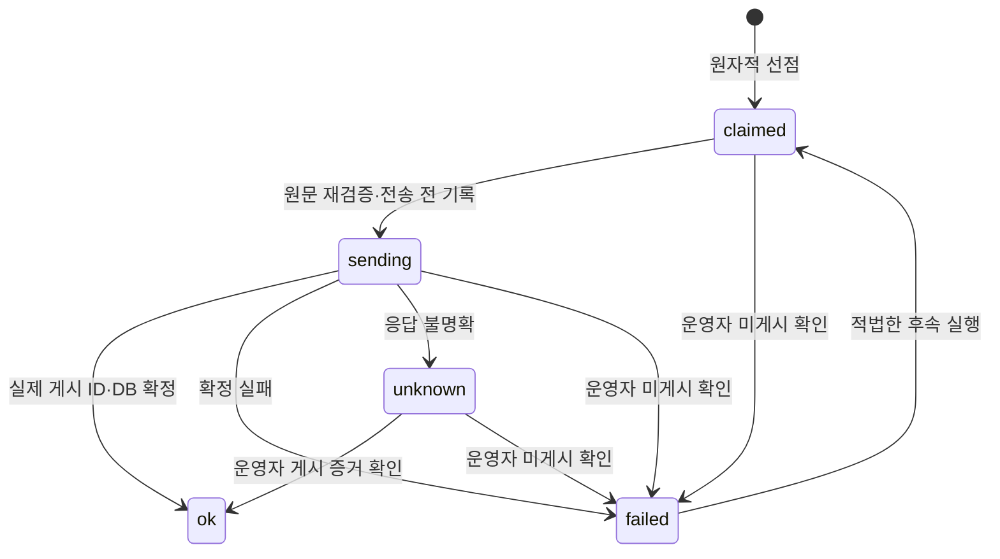

# Comic Novel Facebook 프로세스 설계서 v1.0

기준일: 2026-10-12 KST. 저장소: yumens2-byte/investment-os. 실제 코드 기준 문서이며 배포 결과는 아래 확인 범위와 후속 운영 보고를 구분한다.

## 1. 업무 흐름

기존 일요일 `comic_novel.yml`은 소설 원본을 생성·저장하고 X 전체 발행의 실제 ID·건수·원문 해시를 확인한다. Facebook 금요일 실행은 해당 원본을 소비한다. 소설 재생성, X/TG 콘텐츠 재발행, MVP 투표를 실행하지 않는다. Telegram은 상태 알림에만 사용한다.

1. KST 현재일과 월요일 기준 주차를 계산한다.
2. 실발행은 활성화, 최초일 2026-10-16, 금요일 조건을 순서대로 확인한다.
3. 대상 Page의 미해결 claimed/sending/unknown 이력이 있으면 보류한다. 같은 주 확정 발행이 있으면 스킵한다.
4. `public.comic_novels`에서 `publish_fb_data IS NULL`, `status='published'`, `publish_date <= today_kst`인 가장 오래된 행을 `publish_date ASC, id ASC LIMIT 1`로 읽는다. 없으면 정상 스킵한다.
5. 그 행의 X 전체 발행 증거를 확인한다. 신규 원본은 실제 양수 숫자 ID 목록, 중복 없음, 예상·확인 건수 일치, 원문 SHA-256 일치를 요구한다. 기존 적재분은 사용자가 전체 X 실발행 완료를 확인한 23행에 한해 날짜·원문 해시·확인자·확인 시각을 기록한 1회성 legacy 확인을 허용한다. 미확인 선두를 건너뛰지 않는다.
6. 저장 제목·에피소드 범위·본문을 Facebook 형식으로 구성하고 10,000자 운영 상한을 확인한다. 본문을 절단하지 않는다.
7. preview는 구성 결과만 반환하며 DB 및 Graph 쓰기 없이 종료한다.
8. publish는 DB 원자적 선점 후 표지를 확보하고 sending을 영속 기록한다. 같은 원문·주차·대상에 경합하거나 원문이 변경되면 전송하지 않는다.
9. Facebook 게시 요청을 한 번 수행한다. 실제 post ID 성공이면 이력 ok와 원본 발행일을 하나의 DB 트랜잭션으로 기록한다. 불명확 응답은 unknown으로 유지한다.
10. 결과 JSON을 artifact로 남기고 실발행 성공 또는 보류·실패 상태를 Telegram으로 통지한다. 알림 실패가 게시를 재실행시키지 않는다.

## 2. 상태 전이

sending 상태에서 프로세스가 종료되거나 게시 성공 후 DB 갱신이 실패하면 영속 sending이 남는다. 오래되었다는 이유로 해제하지 않는다. claimed도 자동 만료하지 않는다. unknown은 다음 주 실행도 차단한다. failed는 확정 미게시/실패이며 후속 금요일 실행에서 재선점할 수 있다.

## 3. 스케줄 및 종료 정책

- `.github/workflows/comic_novel_fb.yml`: UTC cron `17 13 * * 5`, 금요일 22:17 KST. 예약 실행에 0~199초 추가 지연이 있다. GitHub 자체 지연도 가능하다.
- 최초 정규일: 2026-10-16. 금요일 조건은 애플리케이션에서도 검사한다.
- workflow 동시 실행 그룹: `comic-novel-facebook`, 실행 중 취소 false, timeout 15분.
- 운영 반영 승인 이후 직접 연결의 anon 권한 오류가 확인되었다. 기존 키를 유지하는 GitHub OIDC gateway를 보완하며 실제 main OIDC smoke VERIFIED 확인 후 workflow 활성 기본값 true를 반영한다. repository variable `FACE_NOVEL_ENABLED=false`는 명시적인 중지 설정이다. CLI 모듈 자체는 환경변수 없을 때 false다.
- 수동 Actions는 preview/publish/reconcile과 dry_run을 제공한다. 기본 선택은 preview, dry_run=true다. reconcile은 claim_id, post_id, confirmed_at, note, not_posted를 입력하며 actor는 github.actor로 기록한다. 운영자 실제 확인 증거가 필요하고 Graph 게시 요청을 하지 않는다.
- exit 0: PREVIEW/PUBLISHED 및 정상 스킵. exit 1: 설정·DB·확정 게시 실패. exit 2: 증거 부족·불확실·내용 보류. Actions에서 보류도 실패 실행으로 드러난다.

## 4. 저장 및 원자성

`public.comic_novels.publish_fb_data DATE NULL`은 실제 확인된 게시 시각을 Asia/Seoul 날짜로 변환해 기록한다. 예약일이나 원본 publish_date를 복사하지 않는다. 보조 `comic_novel_channel_history`는 source_date, channel, target_key, slot_week_start, status, 원문/게시본문 해시, 실제 ID, 건수, run_id, 시각, actor/note를 보관한다.

대상별 advisory transaction lock, 원본·이력 row lock, 활성 주차 unique 제약과 원본·채널·대상 unique 제약을 사용한다. 원본 조회 뒤 변경을 막기 위해 선점 시 원문 해시를 전달하며 sending 전 재검증한다. DB 오류를 빈 큐로 바꾸지 않는다.

## 5. 현재 운영 데이터와 검증 범위

배포 담당자의 운영 PostgreSQL 17.6 확인 결과: 기존 원본 23행 유지, 신규 publish_fb_data는 모두 NULL, 채널 이력 0행, RLS 활성, 6개 RPC의 service_role 실행 허용 및 anon 실행 차단. legacy 확인 테이블은 service_role SELECT만 허용하고 일반 사용자 접근을 제한한다. 사용자가 기존 적재 23행의 X 전체 발행 완료를 확인하여 `comic_novel_legacy_x_confirmations`에 1회성 해시 스냅샷을 기록하는 보완을 적용한다. 이는 실제 post ID를 생성하는 방식이 아니다. 선두 원본은 2026-04-05이며 사용자 확인과 현재 원문 해시가 일치하는 경우 소비할 수 있다. 스냅샷 이후 변경된 원문과 미래 신규 원본에 이 예외를 확장하지 않는다. 운영 backfill은 23행 반영 및 현재 원문 해시 23행 일치 확인 완료. main smoke에서 최초 원본 2026-04-05의 PREVIEW를 확인했다.

legacy 보완 후 검증: Python 3.11.17 관련 회귀 196건 통과, 격리 PGlite PostgreSQL 18.3 SQL 검증 26건 통과. 운영 Page에 실제 게시한 결과가 아니다. 배포 후 연결 확인은 별도 운영 보고로 확정한다.

## 6. 제한 및 운영 대응

- 최초 텍스트 발행이 기본이다. 표지는 storage:// 경로와 바이트 SHA-256이 모두 확보된 경우만 재사용한다. 불일치·미확보 시 텍스트로 발행한다. 새 표지는 생성하지 않는다.
- GET Graph `/me`의 Page ID 일치는 대상 확인이며 게시 권한의 실검증은 아니다.
- 기존 공용 X publisher의 불명확 예외 재시도/텍스트 폴백 정책은 이번 작업에서 변경하지 않았다.
- 장애 시 Page·실행 로그·이력을 대조하여 게시 확인 또는 미게시 확인을 먼저 수행한다. 데이터 삭제나 날짜 NULL 복원으로 재발행하지 않는다.

## 운영 연결 확인 결과 — 2026-10-12

운영 DB 마이그레이션 및 기존 23행 legacy 확인은 완료했다. 최초 직접 연결 점검의 42501은 기존 SUPABASE_KEY가 anon이어서 발생했다. 사용자의 기존 키 유지·로그인 없는 처리 지시에 따라 SUPABASE_KEY를 변경하지 않고 GitHub OIDC 인증 Edge gateway를 사용한다. 신규 GitHub secret을 추가하거나 anon DB 읽기·발행 권한을 열지 않는다. NOVEL_USE_GITHUB_OIDC=true일 때 제한 작업은 gateway를 통한다. gateway v1 ACTIVE 및 실제 main OIDC 무쓰기 smoke VERIFIED를 확인했고 Facebook workflow 활성 기본값 true를 반영한다. 저장소 변수 false로 중지할 수 있다. Facebook 실제 게시와 날짜 갱신은 아직 0건이다.

## 8. 인증 경계 및 호출 흐름

Actions는 id-token: write로 GitHub 단기 OIDC 토큰을 발급받아 기존 SUPABASE_KEY를 apikey로 comic-novel-gateway에 요청한다. gateway는 RSA 서명·GitHub issuer·audience comic-novel:ccomoimhhttaklfadaos·정확한 repo/ID/main/workflow를 검증한 뒤 서버 내부 기본 service_role로 제한 읽기 또는 RPC를 수행한다. Sunday는 X 확인 쓰기, Friday는 Facebook 쓰기, CI push main은 읽기로 구분한다. 기존 키는 유지하고 anon DB 권한을 확대하지 않으며 추가 로그인·신규 GitHub secret을 요구하지 않는다. verify_jwt=false는 이 전용 검증을 사용하기 위한 배포 설정이다.

쓰기 HTTP 호출은 한 번이며 불명확 실패를 자동 재시도하지 않는다. OIDC 적용은 표지 신규 생성·원본 변경·강제 발행 조건 우회를 추가하지 않는다. 운영 preview 및 Page ID 확인은 실제 main OIDC 무쓰기 smoke에서 VERIFIED로 검증했으며 workflow 기본 true를 반영한다.

최신 개발 검증 결과: Python 3.11 관련 회귀 230건, 격리 SQL 26건 통과. Edge RSA 인증 테스트 22건 통과, 실제 main OIDC smoke VERIFIED를 확인했다.

## 운영 연결 확인 결과 — 2026-10-12

[PR #20](https://github.com/yumens2-byte/investment-os/pull/20) main 병합 커밋 60a50c5d, Edge gateway v1 ACTIVE. [main 무쓰기 smoke](https://github.com/yumens2-byte/investment-os/actions/runs/38178503564/job/114585877383)는 VERIFIED이며 기존 database_key_role=anon, 예상 DB 프로젝트, page_identity_verified=true, preview_status=PREVIEW, source_publish_date=2026-04-05, database_writes=0, public_posts=0을 확인했다. 검증은 Python 230건·Edge RSA 22건·격리 SQL 26건 통과다.

첫 정규 발행은 2026-10-16 금요일 22:17 KST다. 연결·Page ID·preview 확인은 실제 게시 권한 또는 실제 Facebook 게시 성공의 증명이 아니다. 실제 게시 및 publish_fb_data 기록은 아직 0건이며 첫 금요일 실행에서 확인한다.
